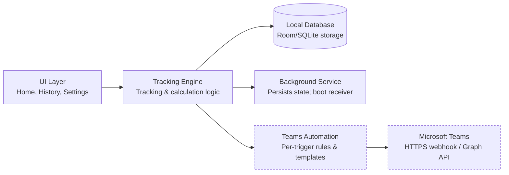
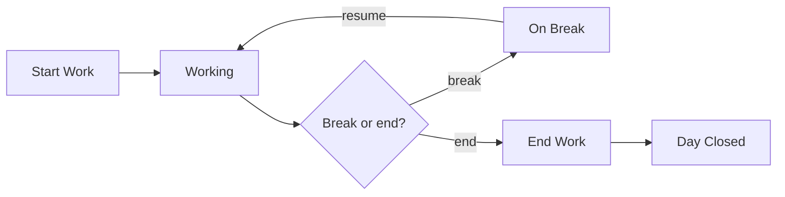
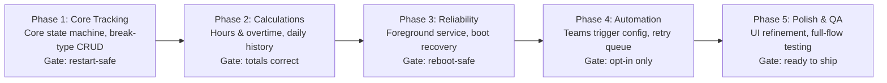

# WorkPulse – Requirements Specification

As of 2026-10-31.

## 1. Purpose and Scope

WorkPulse is a single-user, offline-first mobile app for Android and iOS — built from one shared Flutter/Dart codebase — for tracking daily work sessions and breaks against a personal target, with optional, fully configurable notifications to Microsoft Teams.

**In scope**
- Manual time tracking: start work, start/end breaks (user-defined types), resume work, end day.
- User-defined break types (add, edit, delete), each with its own Teams automation settings.
- Automatic calculation of worked hours, break time, productive hours, remaining hours to target, and overtime.
- Daily history of all activities, viewable for any past day.
- Optional Microsoft Teams messaging per activity/break type, independently enabled and configured, never sent unless explicitly turned on.
- Fully offline local storage; tracking state survives app minimization, app restart, and device restart.
- Per-break-type alarm and reminder configuration (sound, vibration, notification style, reminder behaviour).
- A persistent, real-time status notification in the system notification bar while an activity is active.

**Out of scope for this phase**
- Multi-user accounts, cloud sync/backup, or team-wide reporting.
- Automatic, sensor-based detection of work/break state — all transitions are user-initiated.
- Desktop or web versions of the app — mobile only (Android and iOS).

## 2. Application Modules

Only the Teams Automation module ever leaves the device; the Tracking Engine, UI, and Local Database form a closed, fully offline loop, and the Background Service exists solely to make that loop survive restarts. The same Flutter/Dart codebase renders this on both Android and iOS; only the Background Service's underlying platform plugin differs between them.

## 3. Functional Requirements — Work Time Tracking & Break Types

Activity states follow one path: Not started → Working → (On break → Working)* → Ended.

1. **FR-1.1 Start Work** — starts the day once; records a start timestamp.
2. **FR-1.2 Start Break** — user picks a configured break type; the current Working segment closes (end time + duration) and a break segment opens.
3. **FR-1.3 Resume Work** — closes the active break (end time + duration) and opens a new Working segment.
4. **FR-1.4 End Workday** — closes whichever segment is open and marks the day ended; no further activity is accepted for that day unless explicitly reopened.
5. **FR-1.5 Activity records** — every work or break segment stores activity type, start time, end time (null while in progress), and duration (computed on close).
6. **FR-1.6 Break type management** — add (name, optional description/icon/colour), edit, and delete break types. A break type referenced by historical activity is archived rather than hard-deleted, so past records keep their label even after the type is removed from new-activity pickers.
7. **FR-1.7 Default break types** — Tea Break, Lunch Break, Personal Break, and Other are seeded on first run, and are editable/deletable exactly like any user-created type.
8. **FR-1.8 Single active activity** — only one activity (work, or one specific break) can be open at a time.

## 4. Functional Requirements — Productive Hours Calculation

1. **FR-2.1** Total working hours = sum of durations of all Working segments for the day.
2. **FR-2.2** Total break duration = sum of durations of all break segments for the day (overall, and optionally broken down per break type).
3. **FR-2.3** Total productive hours = total working hours, shown alongside break totals for context.
4. **FR-2.4** Remaining hours to target = max(daily target − total working hours, 0).
5. **FR-2.5** Overtime = max(total working hours − daily target, 0).
6. **FR-2.6** All figures update live while an activity is in progress, using the current time as a provisional end.
7. **FR-2.7** Configurable settings: daily target working hours; allowed break duration (overall and/or per break type); the break types themselves (FR-1.6).
8. **FR-2.8** If total break duration exceeds the allowed break duration, the app flags this visually — it does not block tracking or alter any calculation.

## 5. Functional Requirements — Activity History

1. **FR-3.1** Each day's activities are grouped under that calendar date.
2. **FR-3.2** The history view lists, per activity: type, start time, end time, duration — in chronological order.
3. **FR-3.3** A per-day summary shows total working hours, total break duration, productive hours, and remaining/overtime against that day's target.
4. **FR-3.4** The user can open any previous day and see its full activity log and summary.
5. **FR-3.5** Completed days are read-only in this phase (no retroactive editing — see Assumptions).

## 6. Functional Requirements — Microsoft Teams Automation

1. **FR-4.1 Global toggle** — Teams messaging can be switched on or off entirely, independent of core tracking.
2. **FR-4.2 Per-trigger automation** — Start Work, Resume Work, End Work, and each break type's own Start/End each have their own enable/disable switch.
3. **FR-4.3 Custom templates** — the user writes the message text per trigger, with placeholders (start time, end time, duration, productive hours so far) substituted at send time.
4. **FR-4.4 Configurable destination** — the user sets where each message goes, and destinations can differ per trigger.
5. **FR-4.5 Per-break-type independence** — a new break type gets its own Teams automation (enabled flag, template, destination), disabled by default until the user configures it.
6. **FR-4.6 Send rule (hard requirement)** — a message is sent only if the global toggle is on **and** that trigger is enabled **and** has a valid template and destination. Any other state: nothing is sent — no message is dispatched, no placeholder or partial message goes out.
7. **FR-4.7 End-of-day summary** — the End Work message may include aggregated figures: total worked, total break, productive hours, versus target.
8. **FR-4.8 Non-blocking delivery** — delivery failures are retried or queued, and never alter or block the underlying work-tracking record.

## 7. Non-Functional Requirements

1. **NFR-1 Offline-first** — all core tracking and calculation works with no network connection, ever.
2. **NFR-2 Local persistence** — activities and configuration survive app close, app crash, device reboot, and OS-initiated process kill.
3. **NFR-3 Continuity** — an in-progress activity resumes with the same start time and correct elapsed duration after the app is minimized, backgrounded, killed, or the device restarts.
4. **NFR-4 Accuracy** — durations are computed from wall-clock timestamps, not accumulated in-memory timers, so background suspension never skews a duration.
5. **NFR-5 Isolation** — Teams automation is best-effort and fire-and-forget; its failure, misconfiguration, or lack of network must never prevent, delay, or corrupt work/break tracking.
6. **NFR-6 Data integrity** — a break type referenced by historical activity cannot be hard-deleted (FR-1.6).
7. **NFR-7 Usability** — starting, pausing, or ending an activity should take one or two taps from the main screen.
8. **NFR-8 Privacy** — all data stays on-device by default; nothing leaves the device except the Teams messages the user has explicitly configured.
9. **NFR-9 Theming** — the app fully supports Light Mode and Dark Mode, following the device's system setting by default.
10. **NFR-10 Responsive layout** — screens adapt correctly across different Android and iOS screen sizes, from small phones to large-screen devices, without clipped or misaligned content.

## 8. Data Model (Local Database)

Five local entities cover configuration and history; every total in Sections 3–4 is derived at read time, not stored.

**BreakType**

| Field | Type | Notes |
| --- | --- | --- |
| id | PK | |
| name | text | user-defined, unique |
| description, color/icon | text, optional | for display |
| isDefault | boolean | marks the four seeded types |
| isActive | boolean | false = archived; hidden from new-activity pickers but kept for history |
| createdAt | timestamp | |
| alarmEnabled | boolean | defaults to false (FR-11.2) |
| expectedDurationMinutes | integer, nullable | used to schedule the alert (FR-11.3) |
| alarmSound | text, nullable | chosen sound identifier; empty = platform default |
| vibrationEnabled | boolean | defaults to false |
| notificationPreference | enum | e.g. Banner / Silent |
| reminderBehaviour | enum | Once / Repeat |
| repeatIntervalMinutes | integer, nullable | used only when reminderBehaviour = Repeat |

**Activity**

| Field | Type | Notes |
| --- | --- | --- |
| id | PK | |
| activityType | enum/ref | "Work" or a BreakType id |
| startTime | timestamp | |
| endTime | timestamp, nullable | null while in progress |
| durationSeconds | integer | computed when the activity closes |
| dayKey | date | local calendar date this activity belongs to |
| status | enum | InProgress / Completed |
| scheduledAlarmId | text, nullable | the platform alert's id, for cancellation on resume/end (TR-11) |

**Settings**

| Field | Type | Notes |
| --- | --- | --- |
| dailyTargetMinutes | integer | |
| allowedBreakMinutes | integer | overall allowance; per-type allowances live on BreakType if needed |

**TeamsAutomationConfig**

| Field | Type | Notes |
| --- | --- | --- |
| id | PK | |
| triggerType | enum | StartWork / ResumeWork / EndWork / BreakStart / BreakEnd |
| breakTypeId | FK, nullable | set only for break-specific triggers |
| enabled | boolean | defaults to false |
| messageTemplate | text | with placeholders |
| destination | text | webhook URL or recipient identifier |

**TeamsDeliveryLog** (for troubleshooting, FR-4.8/TR-5)

| Field | Type | Notes |
| --- | --- | --- |
| id | PK | |
| configId, activityId | FK | which trigger and which activity caused the send |
| status | enum | Success / Failed / Queued |
| attemptedAt, retryCount | timestamp, integer | |

Relationships: Activity.activityType references BreakType.id for breaks; TeamsAutomationConfig.breakTypeId references BreakType.id for break-specific triggers; archiving a BreakType disables its TeamsAutomationConfig rows but never touches historical Activity rows (NFR-6).

## 9. Core Workflow

Every break and resume is user-initiated; only one activity is open at a time. Each transition above may also fire its configured Teams message (Section 6, FR-4.6); nothing is sent for a transition whose trigger is not enabled and fully configured.

## 10. UI/UX Design Guidelines

Five screens cover the full flow; Home is reachable in one tap from anywhere.

**Visual design principles**
- Modern, minimal, clean layouts with consistent spacing, typography, and colour usage across every screen.
- A premium productivity-app visual style: rounded corners, subtle shadows, and visually balanced layouts — no unnecessary decoration or excess colour.
- One consistent design system (Material 3 theme) applied everywhere — buttons, cards, inputs, and the status notification all share the same tokens.
- Full Light Mode and Dark Mode support, defaulting to the device's system setting (NFR-9).
- Responsive layouts across Android and iOS screen sizes, from small phones to large-screen devices (NFR-10).

| Screen | Purpose | Key elements |
| --- | --- | --- |
| Home / Today | Start, break, resume, end actions; live timer; today's running totals | Primary action button that changes with state; today's summary card |
| Break Type Picker | Choose a break type when starting a break | List of active break types; link to manage types |
| History | Browse past days | Date picker/calendar, per-day summary, chronological activity list |
| Settings — Tracking & Break Types | Configure daily target, allowed break duration; add/edit/delete break types | Numeric inputs; break-type list with add/edit/delete; per-type alarm settings (sound, vibration, reminder behaviour) |
| Settings — Teams Automation | Global on/off; per-trigger enable, message template, destination | Organised per activity and per break type; each break type's automation reachable from its own edit screen |
| Delivery Log (optional) | Review past Teams message attempts | Success/failed/queued list, for troubleshooting only |

**Navigation:** a bottom nav or drawer with Home, History, and Settings; Settings splits into Tracking & Break Types and Teams Automation. When a break type is created or edited, its Teams automation panel and its alarm settings (Section 13) are both reachable directly from that same screen, so per-break-type configuration is set up at the point of creation rather than as an afterthought.

## 11. Mobile Automation & Teams Integration — Technical Requirements

1. **TR-1 Background continuity** — state is tracked from persisted timestamps, not in-memory counters, so the OS suspending, backgrounding, or terminating the app never loses or corrupts elapsed time.
2. **TR-2 Relaunch recovery** — on any relaunch (after a device restart, an OS-terminated process, or simply reopening the app), it recomputes any activity that was in progress from its stored start timestamp to now; no explicit boot-time hook is required, since nothing lives only in memory between launches. Android may additionally resume a status notification as soon as the device boots, via a boot-triggered receiver; iOS has no equivalent and simply recalculates the next time the app is opened — the underlying data is correct either way.
3. **TR-3 Status indicator** — while an activity is running, a persistent, actionable notification (Break/Resume/End) lets the user see status and act without opening the app, built on each platform's native local-notification APIs behind one shared notification plugin.
4. **TR-4 Decoupled delivery** — sending a Teams message is asynchronous and never blocks the UI or delays recording the activity; the local record is written first, Teams delivery is attempted after.
5. **TR-5 Delivery reliability** — if offline or the send fails, the message is queued and retried with bounded backoff; Android's background retry is comparatively timely and reliable, iOS's is OS-scheduled and opportunistic, so a queued message may also need to flush the next time the app is foregrounded.
6. **TR-6 No duplicate sends** — each activity transition yields at most one queued message per enabled trigger; reopening the app never re-triggers sends for transitions already processed.
7. **TR-7 Configuration validation** — a trigger counts as "configured" (FR-4.6) only when it has both a non-empty destination and a non-empty template; an incomplete trigger is visibly disabled in the UI.
8. **TR-8 Destination mechanism** — Teams receives messages via an HTTPS call from the device to a Teams-side endpoint the user configures per trigger; Section 12 lists the available ways to obtain and call such an endpoint.
9. **TR-9 Secrets handling** — any destination URL or token the user configures is stored locally only, and sent only to that configured Teams endpoint.
10. **TR-10 Alarm scheduling** — break alerts are scheduled via each platform's exact-time scheduling API (Android: exact alarms; iOS: a scheduled local notification), wrapped behind one shared Flutter plugin interface.
11. **TR-11 Alarm cancellation** — ending a break cancels its scheduled platform-level alert immediately, not just in-app state, so nothing fires after the fact.
12. **TR-12 Live notification refresh** — Android updates the ongoing notification roughly once a minute while an activity is active, since continuous per-second updates would cost battery for no real benefit; iOS updates on the same schedule when the OS permits it, but its background execution limits mean updates may lag or pause until the app is foregrounded — see AQ-8.

## 12. Technology Stack

Flutter (Dart) was chosen as a single codebase for both Android and iOS (Section 1); the table below is what that decision resolves to per layer. The Teams delivery mechanism stays an open choice, since it depends on what's available in your Teams tenant.

**Chosen stack**

| Layer | Choice | Why |
| --- | --- | --- |
| UI | Flutter (Dart) | One codebase renders on both Android and iOS with a single Material 3 theme (light and dark); fits the live timers and reactive totals in Sections 3–4 |
| Local data storage | drift (SQLite) | Typed, relational, async access matching the schema in Section 8 |
| Background execution and retry | workmanager (Android) and background_fetch/BGTaskScheduler (iOS), behind one Dart interface | Closest cross-platform fit for the retry queue in TR-5; iOS's scheduling is opportunistic, not guaranteed |
| Notifications | flutter_local_notifications | Actionable notifications (TR-3) from one API on both platforms |
| Teams HTTP calls | the `http` package | Plain HTTPS POST to whichever destination is configured below |

**Microsoft Teams message delivery (still open)**

| Option | Notes |
| --- | --- |
| Power Automate "Workflows" webhook | Microsoft's current channel-webhook mechanism — it has been replacing the older Office 365 "Incoming Webhook" connector, which is being phased out; a simple HTTPS POST to a per-channel URL generated from Teams; minimal setup; one-way posting only |
| Microsoft Graph API (Azure AD app registration + OAuth) | Can target specific chats/users and richer cards; requires registering an app and handling OAuth tokens, i.e. more setup and ongoing maintenance |
| Teams bot (Bot Framework) | Supports two-way interaction and adaptive cards; substantially more infrastructure than one-way notifications need |

This stack satisfies Sections 3–11 on both Android and iOS; only the Teams delivery mechanism above is left for you to pick, since it depends on what's available in your Teams tenant.

## 13. Functional Requirements — Break Alarms & Reminders

Every break type carries its own alarm configuration, separate from its Teams automation settings (FR-4.5).

1. **FR-11.1 Per-type configuration** — every break type (default or custom) can have its own alarm configured independently: enable/disable, expected break duration, alarm sound, vibration preference, notification preference, and reminder behaviour.
2. **FR-11.2 Disabled by default** — alarms are off for every break type, including the four seeded defaults, until the user explicitly turns one on (same opt-in pattern as Teams automation, FR-4.5).
3. **FR-11.3 Scheduling** — starting a break of a type with its alarm enabled schedules a single alert for break start time plus expected duration.
4. **FR-11.4 Firing** — if the break is still active when that time arrives, the app alerts the user per that type's configured sound, vibration, and notification preference, prompting them to resume work.
5. **FR-11.5 Reminder behaviour** — configurable per type as either a single alert at the expected duration, or a repeating reminder at a configured interval until the break ends.
6. **FR-11.6 Auto-cancel** — resuming work (or ending the day) before the alert fires cancels that break's scheduled alert; no stale alert fires after the break has already ended.
7. **FR-11.7 Independent of Teams automation** — a break type's alarm settings and its Teams automation settings (FR-4.5) are configured and triggered independently of each other.

## 14. Functional Requirements — Live Notification Service

1. **FR-12.1 Persistent status notification** — while any activity (Work or a break) is active, a persistent notification is shown in the system notification bar.
2. **FR-12.2 Real-time content** — the notification shows the current activity type and live elapsed time, refreshed automatically without the user opening the app.
3. **FR-12.3 Dynamic updates** — the notification's label, icon/colour, and elapsed time update automatically as the activity changes (e.g., Working to On Break) and as time passes.
4. **FR-12.4 Quick actions** — the notification exposes actions matching the current state (Working: Break, End; On Break: Resume, End), so the user can act without opening the app.
5. **FR-12.5 Dismiss behaviour** — the notification is cleared automatically when the day is ended, and is not dismissible by swipe while an activity is active.
6. **FR-12.6 Platform ceiling** — the refresh rate and "live" feel of this notification is bounded by what each OS allows a background app to update (TR-12); Android supports frequent, reliable updates, iOS does not guarantee the same cadence.

## 15. Incremental Implementation Plan

Phases run in this order; a later phase — Automation most of all — starts only once its predecessor's gate is met, so Teams messaging is never built on top of unreliable tracking.

## 16. Assumptions & Open Questions

1. **AQ-1 Single user, single device** — no multi-device sync is in scope; treat it as a later phase if it's ever needed.
2. **AQ-2 Day boundary** — a day is keyed by device local calendar date; behaviour when an activity spans midnight (e.g., a break started before midnight, resumed after) needs an explicit decision.
3. **AQ-3 History edits** — this spec treats completed days as read-only; confirm whether retroactive corrections to past entries should be supported.
4. **AQ-4 Teams delivery mechanism** — Microsoft has been retiring the legacy Incoming Webhook connector in favour of the Workflows (Power Automate) app for channel webhooks; confirm the current setup available in your Teams tenant before implementation, since exact timelines vary by source.
5. **AQ-5 One active activity at a time** — assumed no overlapping breaks or concurrent activities (FR-1.8); confirm this matches intent.
6. **AQ-6 Status notification** — assumed a persistent notification with quick actions (Break/Resume/End) is wanted (TR-3); confirm.
7. **AQ-7 iOS background retry timing** — accepted trade-off of the Flutter decision (Section 12): a queued Teams message may arrive late, or only once the app is reopened, on iOS specifically, since the OS does not guarantee timely background execution there; confirm this is acceptable.
8. **AQ-8 iOS live-notification ceiling** — iOS does not support a continuously updating, per-second notification the way Android does; a true "live" counter on iOS (e.g. a Live Activity on the lock screen) would need extra native Swift work beyond the shared Flutter codebase. This spec assumes a periodically-refreshed notification (FR-12.6, TR-12) is acceptable on iOS; confirm, or scope in a native Live Activity as a later phase.

---

Full version with rendered diagrams and inline comments: https://claude.ai/artifact/W3aktUdxKitAwSmUAd9bQU
