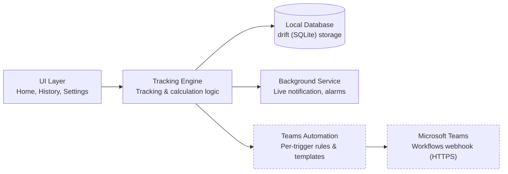
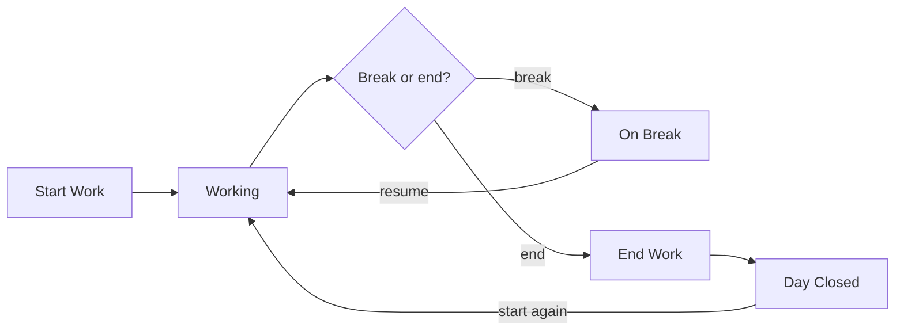

# WorkPulse – Requirements Specification

As of 2026-10-31. Describes the app as built; see Section 15 for what has and hasn't been tested.

## 1. Purpose and Scope

WorkPulse is a single-user, offline-first mobile app built from one Flutter/Dart codebase, for tracking daily work sessions and breaks against a personal target, with optional, fully configurable notifications to Microsoft Teams. Android is built and tested; iOS is scaffolded but has never been built.

**In scope**
- Manual time tracking: start work, start/end breaks (user-defined types), resume work, end day.
- User-defined break types (add, edit, delete), each with its own alarms and Teams automation settings.
- Automatic calculation of worked hours, break time, remaining hours to target, overtime, and expected finish time.
- Daily history of all activities, viewable for any past day.
- Optional Microsoft Teams messaging per activity/break type, independently enabled and configured, never sent unless explicitly turned on.
- Fully offline local storage; tracking state survives app minimization, app restart, and device restart.
- Per-break-type alarms: at set times during the break and at its end, with sound, vibration, notification style and reminder behaviour.
- A persistent, real-time status notification in the system notification bar while an activity is active.

**Out of scope for this phase**
- Multi-user accounts, cloud sync/backup, or team-wide reporting.
- Automatic, sensor-based detection of work/break state — all transitions are user-initiated.
- Desktop or web versions of the app — mobile only (Android and iOS).

## 2. Application Modules

Only the Teams Automation module ever leaves the device; the Tracking Engine, UI, and Local Database form a closed, fully offline loop. The Background Service runs in its own Flutter engine, so tracking and the notification continue with the app closed. It runs on Android only; iOS has no equivalent long-running service.

## 3. Functional Requirements — Work Time Tracking & Break Types

Activity states follow one path: Not started → Working → (On break → Working)* → Ended.

1. **FR-1.1 Start Work** — records a start timestamp and opens a Working segment.
2. **FR-1.2 Start Break** — user picks a configured break type; the current Working segment closes (end time + duration) and a break segment opens.
3. **FR-1.3 Resume Work** — closes the active break (end time + duration) and opens a new Working segment.
4. **FR-1.4 End Workday** — closes whichever segment is open and shows the day as complete. "Start work again" reopens the same day; the time in between counts as neither work nor break, but delays the expected finish (FR-2.9).
5. **FR-1.5 Activity records** — every work or break segment stores activity type, start time, end time (null while in progress), and duration (computed on close).
6. **FR-1.6 Break type management** — add, edit, and delete break types; names must be unique. Deleting an unused type removes it. A type used by past activity is archived instead, so past records keep their label; it can be restored later.
7. **FR-1.7 Default break types** — Tea Break, Lunch Break, Personal Break, and Other are seeded on first run, and are editable/deletable exactly like any user-created type.
8. **FR-1.8 Single active activity** — only one activity (work, or one specific break) can be open at a time. A request the current state doesn't allow, such as a stale notification tap, changes nothing.

## 4. Functional Requirements — Hours Calculation

1. **FR-2.1** Total working hours = sum of durations of all Working segments for the day.
2. **FR-2.2** Total break duration = sum of durations of all break segments for the day. The History day view also breaks this down per break type.
3. **FR-2.3** Removed. "Productive hours" was always identical to total working hours, so it no longer appears anywhere in the app.
4. **FR-2.4** Remaining hours to target = max(daily target − total working hours, 0).
5. **FR-2.5** Overtime = max(total working hours − daily target, 0).
6. **FR-2.6** All figures update live while an activity is in progress, using the current time as a provisional end.
7. **FR-2.7** Configurable settings, in hours and minutes: daily working target (must be above zero) and overall allowed break time. Break types are managed under FR-1.6.
8. **FR-2.8** If total break duration exceeds the allowed break time, the app flags this visually — it does not block tracking or alter any calculation.
9. **FR-2.9 Expected finish** — while an activity is open, expected finish = now + (daily target − total working hours). Example: starting at 9:00 AM with an 8-hour target shows 5:00 PM, and a 15-minute break moves it to 5:15 PM, moving later minute by minute during the break. Once the target is met, the app shows when it was reached.
10. **FR-2.10 Finished time** — once the day has ended, the app shows when it finished instead of an expected finish.

## 5. Functional Requirements — Activity History

1. **FR-3.1** Each day's activities are grouped under that calendar date, newest day first.
2. **FR-3.2** The day view lists, per activity: type, start time, end time, duration — in chronological order. Durations under an hour include seconds.
3. **FR-3.3** A per-day summary shows total working hours, total break duration, and remaining/overtime against that day's target. Each day is scored against the target in force at the time, so changing the target later doesn't rewrite past days.
4. **FR-3.4** The user can open any previous day from the list or a date picker, and see its full activity log and summary.
5. **FR-3.5** Completed days are read-only in this phase (no retroactive editing — see Assumptions).

## 6. Functional Requirements — Microsoft Teams Automation

1. **FR-4.1 Global toggle** — Teams messaging can be switched on or off entirely, independent of core tracking.
2. **FR-4.2 Per-trigger automation** — Start Work, Resume Work, End Work, and each break type's own Start/End each have their own enable/disable switch.
3. **FR-4.3 Custom templates** — the user writes the message text per trigger, with placeholders filled in when the activity changes: `{startTime}`, `{endTime}`, `{duration}`, `{breakType}`, `{date}`, `{worked}`, `{break}`, `{target}`, `{remaining}`, `{overtime}`, `{expectedFinish}`. An unknown placeholder is sent as typed, so a typo is visible.
4. **FR-4.4 Configurable destination** — a default webhook URL applies to every trigger, and any trigger can override it with its own.
5. **FR-4.5 Per-break-type independence** — a new break type has its own Teams automation (enabled flag, template, destination), disabled until the user configures it.
6. **FR-4.6 Send rule (hard requirement)** — a message is sent only if the global toggle is on **and** that trigger is enabled **and** has a non-empty template and a valid https destination. Any other state: nothing is sent — no message is dispatched, no placeholder or partial message goes out.
7. **FR-4.7 End-of-day summary** — the End Work message can include aggregated figures through its placeholders: total worked, total break, versus target.
8. **FR-4.8 Non-blocking delivery** — delivery failures are retried or queued, and never alter or block the underlying work-tracking record.
9. **FR-4.9 Combined triggers** — one action can fire several triggers, in order. Resuming fires that break's End then Resume Work; ending the day during a break fires that break's End then End Work.
10. **FR-4.10 Test and log** — the Teams screen can send a test message to a URL and report the result, and a delivery log shows each message's status, time and any error.

## 7. Non-Functional Requirements

1. **NFR-1 Offline-first** — all core tracking and calculation works with no network connection, ever.
2. **NFR-2 Local persistence** — activities and configuration survive app close, app crash, device reboot, and OS-initiated process kill.
3. **NFR-3 Continuity** — an in-progress activity resumes with the same start time and correct elapsed duration after the app is minimized, backgrounded, killed, or the device restarts.
4. **NFR-4 Accuracy** — durations are computed from wall-clock timestamps, not accumulated in-memory timers, so background suspension never skews a duration.
5. **NFR-5 Isolation** — the tracking record commits first, and alarms and Teams follow; their failure, misconfiguration, or lack of network must never prevent, delay, or corrupt work/break tracking.
6. **NFR-6 Data integrity** — a break type referenced by historical activity cannot be hard-deleted (FR-1.6).
7. **NFR-7 Usability** — starting, pausing, or ending an activity should take one or two taps from the main screen.
8. **NFR-8 Privacy** — all data stays on-device by default; nothing leaves the device except the Teams messages the user has explicitly configured.
9. **NFR-9 Theming** — the app fully supports Light Mode and Dark Mode, following the device's system setting.
10. **NFR-10 Responsive layout** — screens adapt across different Android and iOS screen sizes without clipped or misaligned content. The dashboard never scrolls: its large tile absorbs spare height, and on a screen too short for its minimum layout, the whole dashboard scales down.

## 8. Data Model (Local Database)

Five local tables (schema version 3) cover configuration and history; daily totals are derived at read time, not stored.

**BreakTypes**

| Field | Type | Notes |
| --- | --- | --- |
| id | PK | |
| name | text | user-defined; uniqueness enforced by the app |
| description, colorValue | optional | reserved; no screen uses them yet |
| isDefault | boolean | marks the four seeded types |
| isActive | boolean | false = archived; hidden from break pickers but kept for history |
| createdAt | timestamp | |
| alarmEnabled | boolean | defaults to false (FR-11.2) |
| expectedDurationMinutes | integer | defaults to 15 |
| midBreakAlarmMinutes | text | minutes after the break starts, e.g. "5,10,15" (FR-11.8) |
| alarmSound | enum | Notification / Alarm / Ringtone |
| vibrationEnabled | boolean | defaults to true |
| alertStyle | enum | Pop up / Quiet |
| reminderBehaviour | enum | Once / Repeat |
| repeatIntervalMinutes | integer | defaults to 5; used only for Repeat |

**Activities**

| Field | Type | Notes |
| --- | --- | --- |
| id | PK | |
| kind | enum | Work / Break |
| breakTypeId | FK, nullable | set only for breaks |
| startTime | timestamp | |
| endTime | timestamp, nullable | null while in progress, which is also what marks an activity as open |
| durationSeconds | integer, nullable | computed when the activity closes |
| dayKey | text | local calendar date (yyyy-MM-dd) the activity belongs to |
| targetMinutes | integer, nullable | target in force when recorded (FR-3.3); null on rows older than schema version 2 |

**AppSettings** (a single row)

| Field | Type | Notes |
| --- | --- | --- |
| dailyTargetMinutes | integer | defaults to 480 |
| allowedBreakMinutes | integer | defaults to 60 |
| teamsEnabled | boolean | the global toggle; defaults to false |
| teamsDefaultDestination | text, nullable | default webhook URL |

**TeamsTriggerConfigs** (a trigger with no row is off)

| Field | Type | Notes |
| --- | --- | --- |
| id | PK | |
| trigger | enum | StartWork / ResumeWork / EndWork / BreakStart / BreakEnd |
| breakTypeId | FK, nullable | set only for break-specific triggers |
| enabled | boolean | defaults to false |
| messageTemplate | text | with placeholders |
| destination | text, nullable | overrides the default webhook URL |

**TeamsDeliveries** (outbound queue and delivery log; finished rows are deleted after 30 days)

| Field | Type | Notes |
| --- | --- | --- |
| id | PK | |
| label, message | text | trigger name and the finished message |
| activityId | FK, nullable | the activity that caused the send |
| destination | text | webhook URL used |
| status | enum | Queued / Sending / Sent / Failed |
| attempts, nextAttemptAt | integer, timestamp | retry state (TR-5) |
| lastAttemptAt, lastError | nullable | status or failure type only, never the URL |
| createdAt | timestamp | |

Relationships: archiving a break type disables its Teams triggers but never touches historical activities; deleting an unused type also deletes its Teams triggers (NFR-6).

## 9. Core Workflow

Every break and resume is user-initiated; only one activity is open at a time. Each transition above may also fire its configured Teams message (Section 6, FR-4.6); nothing is sent for a transition whose trigger is not enabled and fully configured.

## 10. UI/UX Design Guidelines

Three tabs cover the main flow, with Home reachable in one tap from anywhere.

**Visual design principles**
- Modern, minimal, clean layouts with consistent spacing, typography, and colour usage across every screen.
- A premium productivity-app visual style: rounded corners, gradients that change colour with the tracking state, pill-shaped buttons and tinted icon badges.
- One consistent design system (Material 3 theme) applied to buttons, cards and inputs.
- Full Light Mode and Dark Mode support, following the device's system setting (NFR-9).
- Responsive layouts, with a dashboard that never scrolls (NFR-10).

| Screen | Purpose | Key elements |
| --- | --- | --- |
| Home | Start, break, resume, end actions; today's running totals | Large tile with state and expected finish time; Worked, Break and Remaining tiles; action buttons that change with state |
| Break Picker | Choose a break type when starting a break | Bottom sheet listing active break types |
| History | Browse past days | Day list, target badge, date picker, then a day view with summary, break breakdown and activity list |
| Settings | Daily target, allowed break time, links to the screens below | Hours-and-minutes picker |
| Break Types | Add, edit, delete and restore break types | List with alarm summary |
| Edit Break Type | Name, alarm settings and that type's Teams messages | Expected duration, alarms during the break, notification style, sound, vibration, reminder |
| Microsoft Teams | Global on/off, default webhook URL, every trigger | Setup instructions, test button, per-trigger status |
| Trigger Editor | Enable, message template, destination override | Tap-to-insert placeholder chips |
| Delivery Log | Review past Teams message attempts | Sent, failed and waiting status, with any error |

**Navigation:** a bottom bar with Home, History, and Settings. A break type's alarm settings and Teams messages are on its own edit screen; a new type's Teams messages become available once it's saved.

## 11. Mobile Automation & Teams Integration — Technical Requirements

1. **TR-1 Background continuity** — state is tracked from persisted timestamps, not in-memory counters, so the OS suspending, backgrounding, or terminating the app never loses or corrupts elapsed time.
2. **TR-2 Relaunch recovery** — any relaunch recomputes the open activity from its stored start timestamp. On Android, the service restarts after a device reboot if it was running; scheduled alarms are restored too. iOS has no equivalent and recalculates the next time the app is opened.
3. **TR-3 Foreground service** — on Android, a foreground service keeps the status notification running while an activity is open. It uses the `specialUse` type because Android 15+ limits `dataSync` services to 6 hours a day, which is shorter than a work day. If Android refuses to start it, the app tries again each time it returns to the foreground.
4. **TR-4 Decoupled delivery** — sending a Teams message is asynchronous and never blocks the UI or delays recording the activity.
5. **TR-5 Delivery reliability** — a failed send retries with growing gaps of up to an hour. A server error gives up after 8 attempts; a rejected request fails immediately. Being offline doesn't use up attempts, but a message stops retrying once it's 24 hours old. On Android, a background job retries once there's a network, even with the app closed; iOS retries only when the app is opened.
6. **TR-6 No duplicate sends** — a message is queued in the same database transaction as its activity change, so each change produces it exactly once, even if the app dies straight afterwards. Each sender claims a message before posting it, so two engines can't send the same one.
7. **TR-7 Configuration validation** — the settings screens show each trigger's status: On, Off, or why it can't send.
8. **TR-8 Destination mechanism** — messages are sent as an Adaptive Card by HTTPS POST to a Teams Workflows webhook (Section 12).
9. **TR-9 Secrets handling** — webhook URLs are stored only on the device, sent only to that endpoint, and never written to the delivery log. Android cloud backup is turned off for the app so they aren't copied off the device.
10. **TR-10 Alarm scheduling** — break alerts are scheduled as exact alarms on Android, falling back to inexact if exact alarms aren't permitted, and as scheduled local notifications on iOS.
11. **TR-11 Alarm cancellation** — ending a break cancels all of its pending alerts and clears any already showing.
12. **TR-12 Live notification refresh** — the notification updates about once a minute and immediately on any change. It doesn't hold a wake lock, to save battery, so its text may lag during deep sleep; recorded times are unaffected. See AQ-8 for iOS.
13. **TR-13 Multiple database connections** — the UI, the background service and retry jobs run in separate Flutter engines, each with its own connection. WAL mode and a busy timeout stop them failing with "database is locked", and each state change takes the write lock up front.

## 12. Technology Stack

Flutter (Dart) was chosen as a single codebase, and Workflows webhooks were chosen for Teams because they need no Azure setup.

**Chosen stack**

| Layer | Choice | Why |
| --- | --- | --- |
| UI | Flutter (Dart) | One codebase with a single Material 3 theme (light and dark) |
| Local data storage | drift (SQLite) | Typed, relational, reactive access matching the schema in Section 8 |
| Background tracking | flutter_foreground_task (Android) | Foreground service with a live notification and action buttons |
| Teams retry | workmanager (Android) | Runs queued messages once there's a network, with the app closed |
| Alarms | flutter_local_notifications | Exact scheduled alerts with sound and vibration options |
| Teams HTTP calls | the `http` package | Plain HTTPS POST to the configured webhook |

**Microsoft Teams message delivery**

| Option | Status | Notes |
| --- | --- | --- |
| Power Automate "Workflows" webhook | **Chosen** | Microsoft's replacement for the older "Incoming Webhook" connector; an HTTPS POST to a URL generated in Teams; minimal setup; one-way posting only |
| Microsoft Graph API (Azure AD app + OAuth) | Not used | Can target specific chats/users, but needs an app registration and token handling |
| Teams bot (Bot Framework) | Not used | Two-way interaction, but far more infrastructure than one-way notifications need |

## 13. Functional Requirements — Break Alarms & Reminders

Every break type carries its own alarm configuration, separate from its Teams automation settings (FR-4.5).

1. **FR-11.1 Per-type configuration** — every break type (default or custom) has its own alarm settings: on/off, expected break duration, alarms during the break, sound (notification tone, alarm tone or ringtone), vibration, notification style (pop up or quiet), and reminder behaviour.
2. **FR-11.2 Disabled by default** — alarms are off for every break type, including the four seeded defaults, until the user turns one on (same opt-in pattern as Teams automation, FR-4.5).
3. **FR-11.3 Scheduling** — starting a break of a type with its alarm enabled schedules its alarms during the break, plus an alert at break start plus expected duration.
4. **FR-11.4 Firing** — if the break is still active when an alert is due, the app raises it using that type's sound, vibration and notification style. Quiet alerts make no sound or vibration.
5. **FR-11.5 Reminder behaviour** — configurable per type as a single alert at the expected duration, or that alert plus up to 12 repeats at a chosen interval until the break ends.
6. **FR-11.6 Auto-cancel** — resuming work or ending the day cancels that break's pending alerts; no stale alert fires after the break has ended.
7. **FR-11.7 Independent of Teams automation** — a break type's alarm settings and its Teams automation settings (FR-4.5) are configured and triggered independently of each other.
8. **FR-11.8 Alarms during the break** — up to 10 alarms per break type, each set as a time after the break starts. For a 1-hour break, alarms at 5, 10 and 15 minutes alert at those times, then the end alarm rings at 1 hour. Each states how far in the break is and how long is left. An alarm can't be added at or past the break length, and shortening the break removes any past the new length.

## 14. Functional Requirements — Live Notification Service

1. **FR-12.1 Persistent status notification** — while any activity (Work or a break) is active, a persistent notification is shown in the system notification bar.
2. **FR-12.2 Real-time content** — the notification shows the current state, expected finish time, and today's worked and break totals, refreshed automatically without the user opening the app.
3. **FR-12.3 Dynamic updates** — the notification's text and buttons update immediately when the activity changes, and about once a minute as time passes.
4. **FR-12.4 Quick actions** — Working shows buttons for the first two active break types plus End work, because Android allows three buttons in total. On Break shows Resume and End work. Tapping the notification opens the app, which offers every break type. Android collapses this low-priority notification, so the user may need to expand it to see the buttons.
5. **FR-12.5 Dismiss behaviour** — the notification is cleared automatically when the day is ended.
6. **FR-12.6 Platform ceiling** — on iOS there is currently no live notification; see AQ-8.

## 15. Implementation Status

All five planned phases have been implemented for Android: core tracking, calculations and history, reliability, automation, and polish. iOS has not been built.

| Area | Verified on | Result |
| --- | --- | --- |
| Tracking, calculations, Teams send rule, retries, migrations | 63 automated tests | Passing |
| Tracking and notification continue with the app closed | Galaxy M32, Android 13 | Passed |
| Notification buttons, including End work with the app closed | Galaxy M32, Android 13 | Passed for break and End work; Resume tested in the app only |
| Alarms during and at the end of a break, firing and cancelling | Galaxy M32, Android 13 | Passed |
| History, settings, Teams screens, light and dark mode | Galaxy M32, Android 13 | Passed |
| Dashboard fits without scrolling | Galaxy M32, plus small and landscape sizes in automated tests | Passed |
| Teams queue, sending and delivery log | Galaxy M32, against a test address that rejects messages | Passed |

**Not yet verified**
- A real message arriving in Microsoft Teams.
- Alarm sound and vibration, the alarm tone, ringtone and quiet options, and repeating reminders on a device.
- Restoring the notification and alarms after a device reboot.
- Starting the service on returning to the foreground after Android refuses it (TR-3); the refusal was seen once but couldn't be reproduced.
- Anything on iOS.

## 16. Assumptions & Open Questions

1. **AQ-1 Single user, single device** — no multi-device sync is in scope; treat it as a later phase if it's ever needed.
2. **AQ-2 Day boundary** — a day is keyed by device local calendar date, and an activity belongs to the day it started; behaviour when an activity spans midnight (e.g., a break started before midnight, resumed after) needs an explicit decision.
3. **AQ-3 History edits** — this spec treats completed days as read-only; confirm whether retroactive corrections to past entries should be supported.
4. **AQ-4 Teams delivery mechanism** — resolved: Workflows webhooks (Section 12). A tenant's policies may still block them; the Teams screen's test button shows this straight away.
5. **AQ-5 One active activity at a time** — implemented as assumed: no overlapping breaks or concurrent activities (FR-1.8).
6. **AQ-6 Status notification** — resolved: implemented with quick actions (FR-12.4).
7. **AQ-7 iOS background retry timing** — a queued Teams message on iOS sends only once the app is reopened; confirm this is acceptable before an iOS release.
8. **AQ-8 iOS live notification** — iOS has no equivalent of the Android foreground service, so it has no live notification today. A live counter there (e.g. a Live Activity on the lock screen) would need extra native Swift work beyond the shared Flutter code; decide whether to scope this in before an iOS release.

---

Full version with rendered diagrams and inline comments: https://claude.ai/artifact/W3aktUdxKitAwSmUAd9bQU
